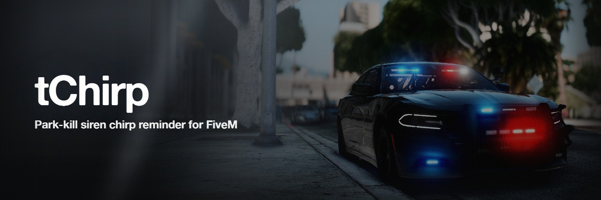

# tChirp

A park-kill chirp reminder for FiveM emergency vehicles.

When a siren is **park killed** — silenced automatically because the car was put in park while still
in pursuit mode — tChirp makes that car chirp at a randomised interval until somebody gets back in
the front seat. That is all it does; tChirp never turns a siren on or off.

Free, MIT-licensed, and not escrowed. There is no encrypted file in it.

- Published documentation: <https://timmygstudios.com/docs/tChirp>
- Requires [tLib](https://timmygstudios.com/docs/tLib) v1.0 or newer, which is also free

## Layout

| Path | What it is |
| --- | --- |
| `config.lua` | **The authority for every default.** Owner-edited; nothing here is required |
| `shared/config-spec.lua` | Validates `config.lua` at startup, on both VMs, before any other chunk runs |
| `client/cl_sirens.lua` | The six-provider siren cascade. Also exported as `IsSirenActive` |
| `client/cl_chirp.lua` | Park-kill detection and chirp playback |
| `client/cl_menu.lua` | `/tchirp` — the in-game status dialog, its one Silence action, and the Feedback tab |
| `server/sv_access.lua` | Who may put a car on the chirp list, through `tlib.access`. Ships `mode = "everyone"` |
| `server/sv_chirp.lua` | The parked-vehicle list, what it refuses from a client, and `tchirp_diag` |
| `server/sv_version.lua` | The startup update check |
| `docs/content/` | The **source** of the published documentation. See below |
| `scripts/tests/` | Lua suites, run in a Lua VM without a game server |

## Working on it

```bash
bun install
bun run test:lua     # the three Lua suites
bun run lint         # biome, over the TypeScript in scripts/
bun run verify       # every gate, controls first
```

Every negative control runs before the gate it controls: a gate nobody has watched fail is an
assertion, not a gate. `prod` is last, because it is the only step that writes anything.

There is no native Lua interpreter on the development machine, so `scripts/test-lua.ts` runs each
suite under Fengari, a Lua VM that runs under bun. The shim in `scripts/run-lua-suite.lua` exists
because Fengari's CLI can print an unhandled Lua error and still exit **zero**, which would report
a suite that blew up on its first line as a pass.

Suites are discovered off disk. A hardcoded list is the one way a runner fails silently — it keeps
passing while the suite nobody added to it is the suite that would have caught the regression.

| Suite | What it pins |
| --- | --- |
| `config-spec.lua` | The shipped config passes its own spec with zero errors and zero warnings; every default matches `config.lua` literal for literal; the inverted-range and assignment-shape rules; a 1.0.0 config still works |
| `sirens.lua` | The three-state provider contract, including ALS's answer-`false`-not-`nil` rule and the ELS-FiveM sender filter |
| `chirp-server.lua` | Everything the server refuses from a client, and the rate limiter |

The stale-entry sweep in `sv_chirp.lua` is **not** covered — its loop parks on its first `Wait`, and
driving it would mean asserting that a stub schedules correctly rather than that the sweep is right.

## Documentation

`docs/content/*.mdx` is the source of <https://timmygstudios.com/docs/tChirp>, and
`docs/product.mdx` is the store listing. Both are owned here.

`bun run docs:check` validates them against the config options, exports, commands and provider order
this resource actually has, so a doc cannot go quietly stale when something changes here.

## Licence

MIT — see [LICENSE](LICENSE).
